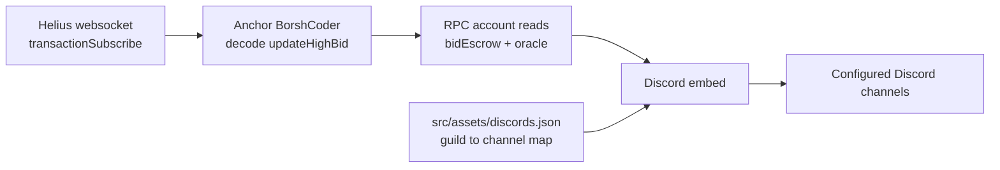

# Radiants Bid Tracker

Discord bot that watches the Radiants DAO NFT bidding program on Solana and announces new high bids.

## What it does

The bot follows a small pipeline:

1. **Helius websocket.** It opens a `transactionSubscribe` subscription on the Helius mainnet websocket for transactions that touch the bidding program (`bidoyoucCtwvPJwmW4W9ysXWeesgvGxEYxkXmoXTaHy`).
2. **Instruction decode.** Each instruction sent to that program is decoded with an Anchor `BorshCoder` built from `idl/nft-bidding.json`. Only `updateHighBid` instructions are handled.
3. **Account reads.** For a new high bid it fetches the `bidEscrow` account to get the NFT collections and counts in the bid, and reads all `oracle` accounts to get each collection's floor price.
4. **Discord embeds.** It builds a "new high bid" embed (NFT count, floor price and estimated value per collection, total value in SOL, bidder address, Solscan and SolanaFM links) and posts it to the channel configured for each Discord server the bot is in.

What runs at HEAD: `src/index.js` starts only the high-bid tracker (`src/highbid-websocket.js`). Two earlier modules, `src/bids-websocket.js` and `src/create-auction-websocket.js`, are still in the repository, but their imports and start calls in `src/index.js` are commented out, so they do not run.

## Architecture



| File | Role |
| --- | --- |
| `src/index.js` | Entry point. Discord client with the `/status` slash command and the `!setchannel` message command, then starts the high-bid tracker. |
| `src/highbid-websocket.js` | High-bid tracker: websocket subscription, instruction decode, account reads, embeds. Reconnects 5 seconds after the socket closes. |
| `src/register-commands.js` | Registers the `/status` slash command in one guild (`CLIENT_ID`, `GUILD_ID`). |
| `src/functions.js` | Uptime helpers and Helius metadata/asset helpers (the latter used only by the inactive modules). |
| `src/bids-websocket.js` | Inactive. Earlier bid notifier. |
| `src/create-auction-websocket.js` | Inactive. Earlier auction notifier for a different program ID. |
| `idl/nft-bidding.json` | Anchor IDL of the bidding program. |
| `src/assets/discords.example.json` | Shape of the per-guild channel config. |

## Setup

Requirements: Node.js, a Discord bot token and a Helius API key.

1. Install dependencies:

   ```sh
   npm install
   ```

2. Copy `.env.example` to `.env` and fill it in:

   | Variable | Used for |
   | --- | --- |
   | `TOKEN` | Discord bot token |
   | `CLIENT_ID`, `GUILD_ID` | Registering `/status` with `src/register-commands.js` |
   | `BOT`, `VERSION` | Name and version shown by `/status` |
   | `HELIUS_API_KEY` | Helius websocket and RPC endpoints |
   | `CHANNEL_ID` | Only read by the inactive `src/create-auction-websocket.js` |

3. Create the guild config. The bot requires this file at startup and fails if it is missing:

   ```sh
   cp src/assets/discords.example.json src/assets/discords.json
   ```

   It maps each Discord server ID to the channel ID where embeds are posted. The file is git-ignored.

4. Optionally register the `/status` slash command:

   ```sh
   node src/register-commands.js
   ```

5. Start the bot from the repository root (`!setchannel` writes to `./src/assets/discords.json`, relative to the working directory):

   ```sh
   node src/index.js
   ```

6. In each Discord server, a member with the Administrator permission sends `!setchannel` in the channel that should receive the announcements. The bot saves that channel in `src/assets/discords.json`.

## Limitations

- No tests.
- The bidding program ID, the accepted collections (Bears Reloaded, Ded Monkes, BAPE, LIFINITY Flares) and the embed images and links are hard-coded. Only the Helius mainnet endpoints are used.
- Two Discord clients log in with the same token: one in `src/index.js` and one in `src/highbid-websocket.js`.
- Several async paths are not awaited or caught (nested async IIFEs in the message handler). A missing oracle account for a collection throws and the embed is not sent.
- The guild config is a local JSON file rewritten in place, with no locking or validation.

## Credits

- [gabrielhicks](https://github.com/gabrielhicks) (Radiants DAO) wrote the high-bid websocket tracker and the updated program IDL, merged via pull request #1, and the floor-price lookup from the oracle accounts, first written on the Radiants-DAO fork (`eca79a8`, `1146203`) and integrated here in `59f7dc6`.
- ANSEL ([anselsol](https://github.com/anselsol)) contributed the IDL-based instruction deserializer.
- [axsxyz](https://github.com/axsxyz) wrote the original bot (bid and auction notifiers, multi-server channel config, NFT image lookup) and integrated the floor-price support.
- The project was forked and extended by the [Radiants-DAO](https://github.com/Radiants-DAO) GitHub organisation.

## License

[MIT](LICENSE)
